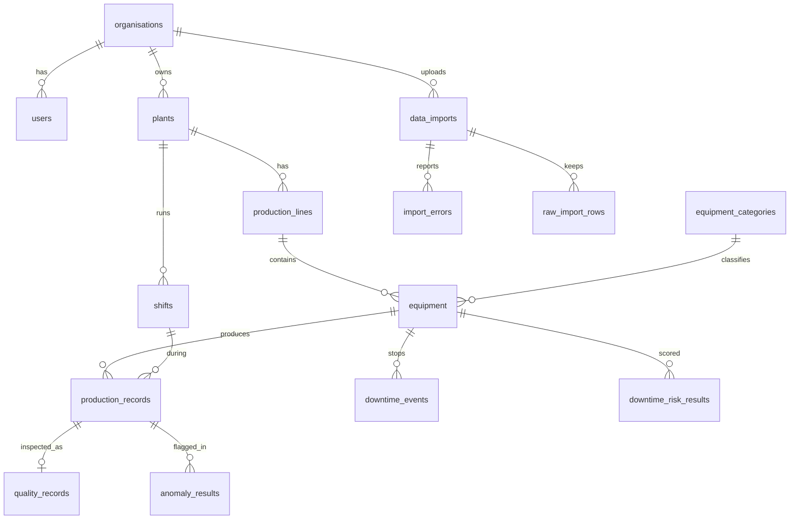

# OpsMind Blueprint

> **Implementation notes (added at V1).** Where the build differs from this plan: migrations are SQL-first and applied by the API itself (not EF migrations); the backend is a single `OpsMind.Api` project, not Api/Domain/Infrastructure; target framework is net10.0; solution file is `OpsMind.slnx`. See `docs/ARCHITECTURE.md` and `docs/KNOWN_LIMITATIONS.md`.


Status: Phase 0 (planning). Nothing below is claimed as implemented until it appears in the README's "Implemented" section.

OpsMind consolidates production, downtime and quality data from several manufacturing plants, validates and stores it, and gives managers dashboards, simple forecasting and anomaly detection, and a question-answering assistant. All data in the demo is synthetic.

## 1. Scope

### MVP (must work end to end before anything else)
- Registration, login, roles (Admin, User), organisation-scoped data access
- CRUD for plants, production lines, equipment categories, equipment, shifts
- CSV/Excel import with validation, duplicate detection, error report, reprocessing, import history
- Dashboard KPIs from SQL queries with filters (plant, line, machine, shift, date range)
- Production forecast with baseline comparison and MAE/RMSE
- Anomaly detection with a reason shown for each flagged record
- CSV and Excel export
- Docker Compose setup, unit and integration tests, GitHub Actions CI

### Advanced (after MVP is stable)
- Equipment downtime risk indicator
- AI assistant with tool calling
- PDF reports and report history
- Playwright end-to-end tests
- Power BI report and `reporting` star-schema views
- Audit log viewer, health and troubleshooting page

### Optional (only if time remains)
- RAG over maintenance documents (pgvector)
- SQL Server import example (T-SQL)
- Azure deployment and Azure Data Factory pipeline

## 2. Architecture

```
React + TS (Vite)  --HTTPS/JSON-->  ASP.NET Core API  --EF Core/Npgsql-->  PostgreSQL (+pgvector)
                                          |                                     ^
                                          | HTTP (internal)                     |
                                          v                                     |
                                   Python service (FastAPI) ---- psycopg/SQLAlchemy (read, and write for ETL results)
                                     - etl/   file parsing, validation, load
                                     - ml/    forecast, anomaly, risk
                                          
ASP.NET Core API --HTTPS--> Gemini API (assistant only, optional)
```

Decisions and reasons:

| Decision | Reason | Trade-off |
|---|---|---|
| One Python service with `etl/` and `ml/` modules | Both need pandas and DB access; one container is simpler to run and deploy | Less isolation than two services; split later if load differs |
| .NET API is the only service the browser talks to | One place for authentication, authorisation and tenant filtering | Extra hop for ML calls |
| ASP.NET Core `PasswordHasher` + JWT in HttpOnly cookie | No token in JavaScript reach; hashing is PBKDF2 with per-user salt | Needs CSRF care: SameSite=Strict plus a custom header check |
| Tenant isolation via `OrganisationId` and EF Core global query filters | Forgetting a `Where` cannot leak data | Raw SQL and the Python service must filter by organisation themselves |
| Import flow: upload, store file hash, create `data_imports` row, Python processes, results written to DB | Idempotent by file hash plus row natural keys; status is visible to the user | Needs a status polling endpoint |
| Assistant uses fixed tools backed by parameterised queries | No model-written SQL, so no injection path to the database | Only questions covered by tools can be answered |
| Downtime risk starts as a rules/statistics indicator | Synthetic labels generated by rules would make a trained model circular | A classifier may be added later as a clearly labelled experiment |
| Forecasting: seasonal-naive and moving-average baselines, XGBoost on lag features, Prophet if it installs cleanly | Honest comparison against simple baselines | Prophet adds a heavy dependency; decide in Phase 6 |
| LLM model name is an environment variable | Free-tier model availability changes; 2.5-series Gemini models were reported to retire on 16 Oct 2026, so confirm the current Flash model in Google AI Studio | None |

## 3. Database design

Tenant tables carry `organisation_id`. Timestamps are `timestamptz` in UTC. Every table has `created_at`; mutable tables have `updated_at`.

| Table | Key columns and constraints |
|---|---|
| organisations | id, name (unique) |
| users | id, organisation_id FK, email (unique), password_hash, full_name, role (Admin/User), is_active |
| plants | id, organisation_id FK, name, code, location, timezone; unique (organisation_id, code) |
| production_lines | id, plant_id FK, name, code; unique (plant_id, code) |
| equipment_categories | id, organisation_id FK, name; unique (organisation_id, name) |
| equipment | id, production_line_id FK, category_id FK, asset_code, name, ideal_rate_per_hour, commissioned_on, status; unique (production_line_id, asset_code) |
| shifts | id, plant_id FK, name, start_time, end_time; unique (plant_id, name) |
| production_records | id, equipment_id FK, shift_id FK, shift_date, units_produced, target_units, run_minutes, import_id FK; unique (equipment_id, shift_id, shift_date); check units >= 0 |
| downtime_events | id, equipment_id FK, start_time, end_time, category (Planned/Unplanned), reason_code, notes, import_id FK; unique (equipment_id, start_time); check end_time > start_time |
| quality_records | id, production_record_id FK unique, inspected_units, rejected_units, defect_type; check rejected <= inspected |
| data_imports | id, organisation_id FK, file_name, file_sha256, source, status, row_count, accepted_count, rejected_count, uploaded_by FK, uploaded_at, finished_at; unique (organisation_id, file_sha256) |
| raw_import_rows | id, import_id FK, row_number, payload jsonb |
| import_errors | id, import_id FK, row_number, field, error_code, message, resolved |
| forecast_results | id, organisation_id FK, scope (plant/line/equipment id), model_name, horizon_start, horizon_end, predicted jsonb, mae, rmse, baseline_mae, baseline_rmse, trained_through, created_at |
| anomaly_results | id, organisation_id FK, production_record_id FK, method, score, reason jsonb, detected_at |
| downtime_risk_results | id, equipment_id FK, as_of, risk_score, risk_band, factors jsonb, method |
| chat_conversations / chat_messages | conversation per user; messages store role, content, tool calls, sources |
| report_history | id, organisation_id FK, user FK, report_type, filters jsonb, period_start, period_end, file_path, created_at |
| audit_logs | id, organisation_id, user_id, action, entity, entity_id, before/after jsonb, ip, created_at |

Indexes: `(equipment_id, shift_date)` on production_records, `(equipment_id, start_time)` on downtime_events, `(organisation_id, uploaded_at desc)` on data_imports, plus foreign key indexes. Index choices will be confirmed with `EXPLAIN ANALYZE` on the generated data, and the results documented.

Entity relationships (Mermaid, rendered on GitHub):



## 4. KPI definitions

| KPI | Definition |
|---|---|
| Total production | SUM(units_produced) |
| Target attainment | SUM(units_produced) / SUM(target_units) |
| Planned production time | Shift minutes minus planned downtime minutes |
| Availability | (Planned production time minus unplanned downtime) / planned production time |
| Unplanned downtime | SUM of downtime_events minutes where category = Unplanned |
| Defect rate | SUM(rejected_units) / SUM(inspected_units) |
| Utilisation | SUM(run_minutes) / total scheduled shift minutes |
| Performance (advanced) | units_produced / (ideal_rate_per_hour x run_minutes / 60) |
| OEE (advanced) | Availability x Performance x (1 - defect rate) |

Downtime events overlapping shift boundaries are split by shift in the SQL view; this rule is documented and tested.

## 5. API surface (v1)

- `POST /api/auth/register`, `/login`, `/logout`; `GET /api/auth/me`
- `/api/plants`, `/api/lines`, `/api/equipment-categories`, `/api/equipment`, `/api/shifts` (GET list, GET id, POST, PUT, DELETE)
- `POST /api/imports` (multipart), `GET /api/imports`, `GET /api/imports/{id}`, `GET /api/imports/{id}/errors`, `POST /api/imports/{id}/reprocess`
- `GET /api/analytics/summary|trend|plant-comparison|shift-productivity|downtime-pareto|utilisation` (shared filter query string)
- `GET /api/predictions/forecast|anomalies|downtime-risk`, `POST /api/predictions/forecast/run`
- `POST /api/assistant/conversations`, `POST /api/assistant/conversations/{id}/messages`
- `GET /api/exports/records.csv|summary.xlsx`, `POST /api/reports`, `GET /api/reports`
- `GET /health/live`, `GET /health/ready`, `GET /api/admin/audit-logs`
- Swagger UI at `/swagger`

Python service (internal only): `POST /etl/process`, `POST /ml/forecast`, `POST /ml/anomalies`, `POST /ml/downtime-risk`, `GET /health`.

## 6. Data science method

- Forecasting: daily units per plant. Time-ordered split (last 28 days held out), rolling-origin evaluation, features built only from past values. Report MAE and RMSE for seasonal-naive, moving average, XGBoost (and Prophet if used). State the limits of synthetic data.
- Anomaly detection: compare a robust z-score (median/MAD per machine) with Isolation Forest on features such as units per run hour, reject rate and downtime minutes. Reasons shown come from the z-score contributions; Isolation Forest scores are shown as supporting evidence only. There are no ground-truth anomaly labels in real use, so evaluation on synthetic data uses injected anomalies and is described as such.
- Downtime risk: indicator from recent unplanned downtime frequency, time since last failure and MTBF trend, labelled "rules-based indicator, not validated".

## 7. Security

- Passwords hashed with PBKDF2 via ASP.NET Core `PasswordHasher`; JWT in HttpOnly, Secure, SameSite=Strict cookie
- Tenant filter on every query; integration tests assert organisation A cannot read organisation B
- Admin-only endpoints use policy-based authorisation
- Upload limits, extension and content checks; parsing happens in the Python service, files are never executed
- Assistant: fixed tool list, parameterised queries, organisation id taken from the token (never from the model), retrieved text treated as data, output labelled as evidence/prediction/hypothesis/recommendation
- Secrets only in environment variables; `.env` is git-ignored

## 8. Repository layout

```
opsmind/
  backend/            ASP.NET Core solution (Api, Domain, Infrastructure, Tests)
  frontend/           React + TypeScript + Tailwind (Vite)
  services/analytics/ FastAPI service: etl/, ml/, tests/
  database/           SQL scripts: views (reporting schema), stored procedures, tsql-example/
  data/               data generator and generated sample files
  powerbi/            Power Query M, DAX measures, build guide
  docs/               blueprint, KPI definitions, support runbook, interview notes
  deploy/azure/       optional Azure notes and templates
  .github/workflows/  CI
  docker-compose.yml
  .env.example
```

## 9. Roadmap

| Phase | Output | Verified here? |
|---|---|---|
| 0 | Blueprint, skeleton, compose with database | Files only |
| 1 | Backend: entities, migration, auth, tenant filter, CRUD, Swagger, health | Cannot compile here (no .NET SDK); verify with `docker compose build` |
| 2 | Frontend shell, auth, management pages | Build and component tests here |
| 3 | Data generator, ETL, import centre | Pytest here |
| 4 | KPI SQL, endpoints, dashboards | SQL against Postgres if available; otherwise on your machine |
| 5 | Forecast, anomaly, risk | Pytest and metrics here |
| 6 | Assistant | Unit tests with a fake LLM here |
| 7 | Exports, reports, Power BI assets | Files here, `.pbix` assembled by you in Power BI Desktop |
| 8 | Tests, CI, Docker, Azure notes | CI config checked; deployment by you |

## 10. UK job-description mapping

| Module | Evidence it gives |
|---|---|
| ASP.NET Core API, EF Core, LINQ, async | .NET developer, full-stack |
| PostgreSQL schema, CTEs, window functions, indexes, `EXPLAIN` | SQL, data analyst, data engineer |
| T-SQL import example | SQL Server experience (optional) |
| ETL with validation and idempotency | data engineer |
| Dashboards, KPI definitions, Power BI, Excel exports | BI analyst |
| Forecast and anomaly evaluation | data scientist |
| Assistant with tool calling | AI/ML engineer |
| Health checks, audit log, support runbook | application support |
| Azure notes | cloud familiarity (optional) |
